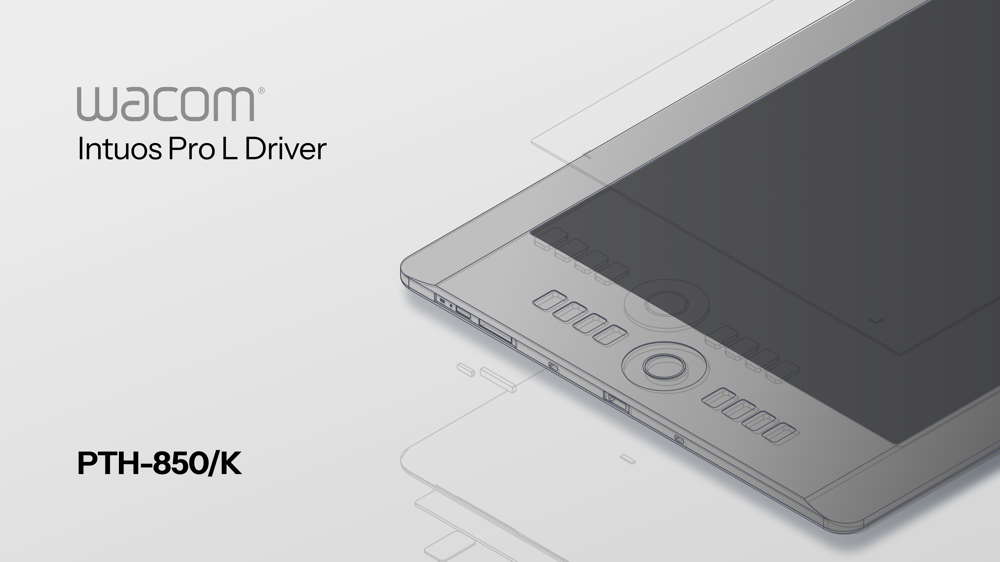

# WaccomDrive



A native macOS USB driver and settings app for the Wacom Intuos Pro Large PTH-851/K. No third-party dependencies or kernel extension.

## Features

- Pen input with pressure, tilt, eraser detection, and configurable side buttons.
- Display mapping, tablet active area, rotation, and optional aspect-ratio preservation.
- Pressure sensitivity and tip activation controls, with named local JSON profiles and button-driven cycling.
- Eight ExpressKeys and ring-center button mapping with a visual tablet diagram, including Touch on/off.
- Touch-ring brush-size control with direction and response settings.
- Surface touch on/off, one-finger pointer/tap, and two-finger scrolling.
- Pen-range palm rejection while the driver is active.
- USB receiver detection and tablet-reported connection capabilities.
- Wireless-module detection, battery percentage, and charging status over USB or the Wacom receiver.
- Settings save, backup, and import.
- Menu-bar access without a Dock icon.
- Installer, uninstaller, and start-at-login option.

## What works

Checklist for the Intuos Pro Large PTH-851/K. Checked items have recorded working behavior or automated checks, as noted. Unchecked items still need implementation or hands-on verification; implemented does not mean verified in a drawing app.

- [x] Direct USB pen input and basic drawing in Krita.
- [x] Pen hover/proximity, position, tip contact, dragging, and release (decoder/event checks).
- [x] Pressure input across the 0–2047 range (decoder/event checks).
- [x] Adjustable pressure sensitivity and tip activation threshold (settings/event checks).
- [x] Pen tilt X/Y decoding and tablet-event output (decoder checks).
- [ ] Confirm tilt-sensitive brush behavior in a drawing app.
- [x] Physical eraser switching and eraser pressure verified in a drawing app.
- [x] Two pen side-button mappings (event-generation checks).
- [x] Eight ExpressKeys and ring-center button decoding and action mapping (decoder/event checks).
- [ ] Verify physical ExpressKey numbering and every button on the tablet.
- [x] Button actions: right/middle click, undo/redo, brush/eraser shortcuts, brush size, Space/pan, and Shift/Option/Command/Control (mapping implemented; representative event checks).
- [x] Touch-ring brush-size shortcuts, direction reversal, and response adjustment (event-generation checks).
- [x] Touch-ring brush-size changes verified in a drawing app over the wireless receiver.
- [ ] Four selectable ring modes are not implemented.
- [x] Custom tablet active area, 180° rotation, and aspect-ratio preservation (mapping/settings checks).
- [ ] Verify display selection and mapped cursor alignment on real single/multiple-display setups.
- [x] Surface-touch enable/disable, one-finger pointer movement, tap-to-click, and pointer speed (event-generation checks).
- [x] Two-finger horizontal/vertical scrolling (event-generation checks).
- [x] Pen-range palm rejection and lift-to-resume protection (automated checks; requires exclusive touch-interface access).
- [ ] Verify touch gestures, palm rejection, and the physical touch switch end to end on the tablet.
- [ ] Pinch-to-zoom, rotation, and additional macOS trackpad gestures (not implemented).
- [x] Wireless-module presence, battery percentage, and charging-status decoding over USB (captured-report checks).
- [ ] Verify battery/charging updates across a live charge/discharge cycle.
- [x] Wacom USB receiver report decoding: pen, all eight ExpressKeys, ring, touch, battery, and disconnect cleanup (captured-report replay).
- [x] Wireless pen input and basic touch (pointer, tap-to-click, two-finger scrolling) confirmed on the PTH-851 receiver.
- [ ] Verify receiver disconnect/reconnect and wireless input recovery end to end.
- [ ] Verify pen, buttons, and gestures in drawing apps beyond Krita.

## Compatibility and limitations

- Requires macOS 27 or later; tested on macOS 27.0.1 with Apple silicon.
- Installer targets arm64; Intel Macs and universal builds are unsupported.
- Developed with Swift 6.4 and Apple's macOS SDK/tools.
- Tested device: Intuos Pro Large PTH-851/K, USB ID `056A:0317` (`Intuos5 touch L`). Other models are unverified.
- Supports the tested PTH-851 over direct USB or Wacom receiver `056A:0084`; other paired models are rejected. Native Bluetooth input is unsupported.
- Basic pen input tested in Krita; wireless pen, basic touch, and touch-ring brush-size changes verified. Other apps and advanced mapping still need testing.
- No pinch, rotation, or full macOS trackpad gestures.
- Palm rejection requires exclusive touch-interface access and an active driver.
- Concurrent use with other tablet drivers is unverified.
- Requires Input Monitoring and Accessibility permissions.
- ExpressKey numbering, tilt-specific brush behavior, and the complete install/login/uninstall cycle remain unverified.

## Build and run

```sh
./script/build_and_run.sh
```

- Builds the app and diagnostic CLI, runs checks, and opens `build/WaccomDrive.app`.
- Build only: `./script/build_and_run.sh --build`.
- Create an installer: `./script/package.sh --local`.
- Installer output: `build/installer/`.
- Welcome artwork: `previews/cover-dev.png` for local builds; `previews/cover.png` for production (`--release` / `--signed-app`).
- Uninstall from Settings or use the companion `Uninstall WaccomDrive.command`.
- GitHub Actions are excluded; builds run locally.

## Signing

- The build selects an available Developer ID Application or Apple Development identity; otherwise it uses ad hoc signing.
- Override the identity with `WACCOM_SIGN_IDENTITY`:

```sh
WACCOM_SIGN_IDENTITY='Developer ID Application: Your Name (TEAMID)' ./script/build_and_run.sh --build
```

- For local ad hoc signing, use `WACCOM_SIGN_IDENTITY=-`.
- Ad hoc rebuilds can require renewed input permissions. Signing does not grant permissions automatically.
- Distribution app ZIP: `./script/package.sh --signed-app` with a Developer ID Application identity.
- Distribution installer: `./script/package.sh --release`; also requires Developer ID Installer, selected automatically or through `WACCOM_INSTALLER_IDENTITY`.
- Downloaded releases also need Apple's notarization process for default Gatekeeper acceptance.
- Keep certificates, private keys, and credentials outside source control.

## Settings and diagnostics

- Settings: `~/Library/Application Support/WaccomDrive/settings.json`.
- Pressure profiles: individual JSON files in `~/Library/Application Support/WaccomDrive/PressureProfiles/`. Manage them on Pen; backups include profiles.
- Assign Cycle pressure profiles after creating profiles. Each press advances through the displayed list and applies it immediately.
- Save & Apply activates changes; imported settings require Save & Apply.
- Brush-size actions use the drawing app's `[` and `]` shortcuts.
- CLI device inventory: `build/waccom-capture --probe`.
- Decoder and settings checks: `build/waccom-capture --self-check`.
- Capture replay: `build/waccom-capture --replay=captures/first-session-excerpt.txt`.

## Guided captures for other tablets

- Run `./tools/capture/capture_tablet.command` to build and start the capture guide.
- Each step requires explicit confirmation; repeats, skips, unavailable features, and partial sessions are preserved.
- Saves raw reports, device identity/descriptors, capability evidence, and notes under `tools/capture/captures/`. This does not add driver support automatically.
- See [capture instructions and limitations](tools/capture/README.md).

## Tablet artwork

- [Model index](assets/tablet/models.json): Intuos Pro models and three SVG slots per model—base, overlay, and ExpressKeys.
- Existing artwork is assigned to PTH-851; unassigned models use `null` image locations.
- See [catalog format and image roles](assets/tablet/README.md).

## Distribution

You may freely use and build on top of the available source code, as long as you credit back in the license.
