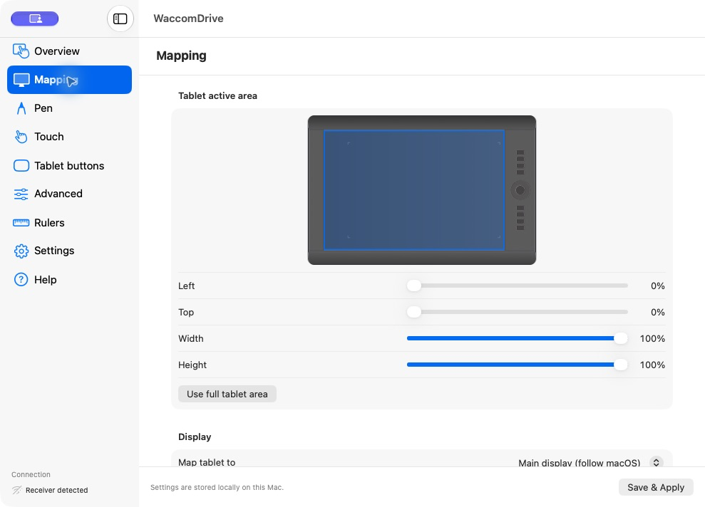
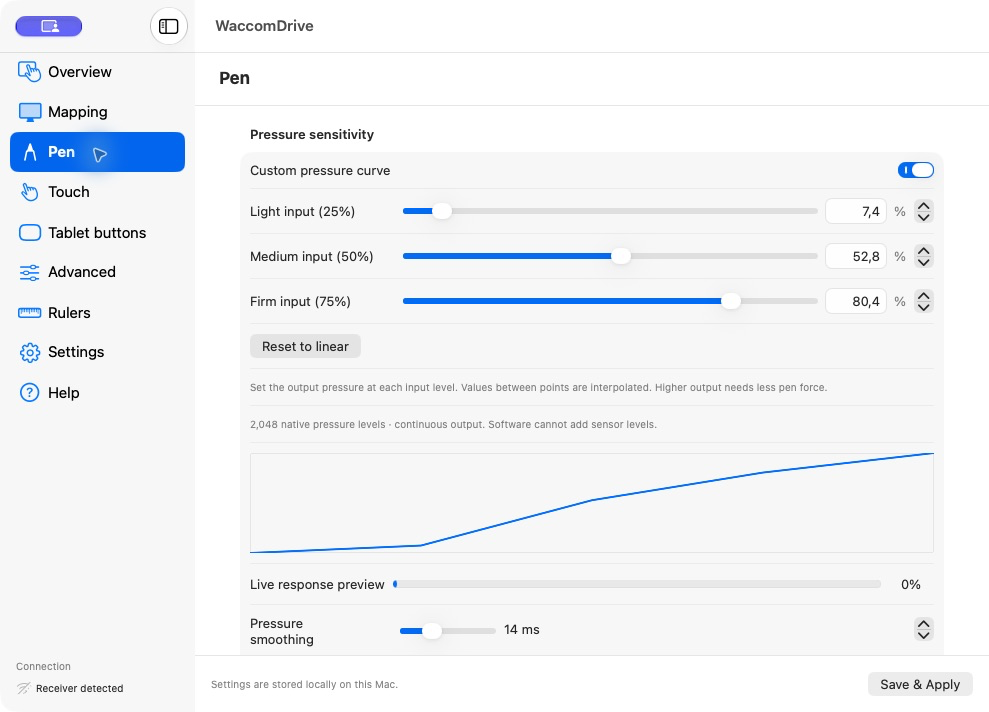
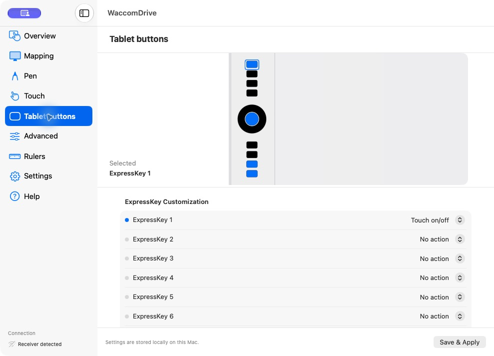

# WaccomDrive


A native macOS USB driver and settings app for the Wacom Intuos Pro Medium PTH-651/K and Large PTH-851/K. No third-party dependencies or kernel extension.

## Features

- Pen input with pressure, tilt, eraser detection, and configurable side buttons.
- Display mapping, tablet active area, rotation, and optional aspect-ratio preservation.
- Pressure sensitivity and tip activation controls, with named local JSON profiles and button-driven cycling.
- Adjustable pressure smoothing (0–50 ms; default 12 ms) softens report-to-report changes without delaying pen lift. Higher smoothing adds response delay.
- Custom pressure curve: adjust output at 25%, 50%, and 75% input with numeric entry and 0.1% steps. Native input remains 2,048 levels; output uses floating-point pressure, so software cannot create additional sensor detail.
- Eight ExpressKeys and ring-center button mapping with a visual tablet diagram, including Touch on/off.
- Custom keyboard shortcuts for pen buttons, ExpressKeys, and the ring center. Choose Custom shortcut, record a key (for example I for eyedropper) with optional modifiers, then Save & Apply. Escape cancels recording; custom keys stay held until the tablet button is released.
- Touch-ring brush-size control with direction and response settings.
- Surface touch on/off, one-finger pointer/tap, and two-finger scrolling.
- Pen-range palm rejection while the driver is active.
- USB receiver detection and tablet-reported connection capabilities.
- Wireless-module detection, battery percentage, and charging status over USB or the Wacom receiver.
- Settings save, backup, and import.
- Menu-bar access without a Dock icon.
- Installer, uninstaller, and start-at-login option.

## Screenshots

| Connection and battery | Display and tablet mapping |
| --- | --- |
|  |  |

| Pen pressure profiles | ExpressKey customization |
| --- | --- |
|  |  |

| Touch and palm rejection | Settings and installation |
| --- | --- |
|  |  |

## What works

Checklist for the Intuos Pro Large PTH-851/K. Checked items have recorded working behavior or automated checks, as noted. Unchecked items still need implementation or hands-on verification; implemented does not mean verified in a drawing app.

- [x] Direct USB pen input and basic drawing in Krita.
- [x] Pen hover/proximity, position, tip contact, dragging, and release (decoder/event checks).
- [x] Pressure input across the 0–2047 range (decoder/event checks).
- [x] Adjustable pressure sensitivity and tip activation threshold (settings/event checks).
- [x] Pen tilt X/Y decoding and tablet-event output (decoder checks).
- [ ] Confirm tilt-sensitive brush behavior in a drawing app.
- [x] Physical eraser switching and eraser pressure verified in a drawing app.
- [x] Two pen side-button mappings (event-generation checks).
- [x] Eight ExpressKeys and ring-center button decoding and action mapping (decoder/event checks).
- [ ] Verify physical ExpressKey numbering and every button on the tablet.
- [x] Button actions: right/middle click, undo/redo, brush/eraser shortcuts, brush size, Space/pan, and Shift/Option/Command/Control (mapping implemented; representative event checks).
- [x] Touch-ring brush-size shortcuts, direction reversal, and response adjustment (event-generation checks).
- [x] Touch-ring brush-size changes verified in a drawing app over the wireless receiver.
- [ ] Four selectable ring modes are not implemented.
- [x] Custom tablet active area, 180° rotation, and aspect-ratio preservation (mapping/settings checks).
- [ ] Verify display selection and mapped cursor alignment on real single/multiple-display setups.
- [x] Surface-touch enable/disable, one-finger pointer movement, tap-to-click, and pointer speed (event-generation checks).
- [x] Two-finger horizontal/vertical scrolling (event-generation checks).
- [x] Pen-range palm rejection and lift-to-resume protection (automated checks; requires exclusive touch-interface access).
- [ ] Verify touch gestures, palm rejection, and the physical touch switch end to end on the tablet.
- [ ] Pinch-to-zoom, rotation, and additional macOS trackpad gestures (not implemented).
- [x] Wireless-module presence, battery percentage, and charging-status decoding over USB (captured-report checks).
- [ ] Verify battery/charging updates across a live charge/discharge cycle.
- [x] Wacom USB receiver report decoding: pen, all eight ExpressKeys, ring, touch, battery, and disconnect cleanup (captured-report replay).
- [x] Wireless pen input and basic touch (pointer, tap-to-click, two-finger scrolling) confirmed on the PTH-851 receiver.
- [ ] Verify receiver disconnect/reconnect and wireless input recovery end to end.
- [ ] Verify pen, buttons, and gestures in drawing apps beyond Krita.

## Compatibility and limitations

- Requires macOS 27 or later; tested on macOS 27.0.1 with Apple silicon.
- Installer targets arm64; Intel Macs and universal builds are unsupported.
- Developed with Swift 6.4 and Apple's macOS SDK/tools.
- Tested devices: Intuos Pro Large PTH-851/K (`056A:0317`) and Medium PTH-651/K (`056A:0315`). macOS may advertise them as Intuos5 touch L/M.
- Supports PTH-651/K (`056A:0315`) and PTH-851/K (`056A:0317`) over direct USB or Wacom receiver `056A:0084`, using model-specific pen coordinates. Medium USB pen input confirmed in a short drawing test; its other controls and receiver input still need hands-on verification. Other models are rejected. Native Bluetooth input is unsupported.
- Basic pen input tested in Krita; wireless pen, basic touch, and touch-ring brush-size changes verified. Other apps and advanced mapping still need testing.
- No pinch, rotation, or full macOS trackpad gestures.
- Palm rejection requires exclusive touch-interface access and an active driver.
- Concurrent use with other tablet drivers is unverified.
- Requires Input Monitoring and Accessibility permissions.
- ExpressKey numbering, tilt-specific brush behavior, and the complete install/login/uninstall cycle remain unverified.

## Build and run

```sh
./script/build_and_run.sh
```

- Builds the app and diagnostic CLI, runs checks, and opens `build/WaccomDrive.app`.
- Build only: `./script/build_and_run.sh --build`.
- Create an installer: `./script/package.sh --local`.
- Installer output: `build/installer/`.
- Welcome artwork: `previews/cover-dev.png` for local builds; `previews/cover.png` for production (`--release` / `--signed-app`).
- Uninstall from Settings or use the companion `Uninstall WaccomDrive.command`.
- GitHub Actions are excluded; builds run locally.

## Signing

- The build selects an available Developer ID Application or Apple Development identity; otherwise it uses ad hoc signing.
- Override the identity with `WACCOM_SIGN_IDENTITY`:

```sh
WACCOM_SIGN_IDENTITY='Developer ID Application: Your Name (TEAMID)' ./script/build_and_run.sh --build
```

- Forks can build and run locally without the original developer's certificate or a paid Apple Developer account. The build falls back to ad hoc signing when no signing certificate is available.
- To explicitly use ad hoc signing: `WACCOM_SIGN_IDENTITY=- ./script/build_and_run.sh`.
- Local builds still require Input Monitoring and Accessibility. Ad hoc rebuilds may require granting those permissions again; signing does not grant them automatically.
- Ad hoc signing is sufficient for local builds but does not provide Gatekeeper trust for downloaded apps. Developer ID signing and notarization are needed for normal distribution outside the Mac App Store.
- Distribution app ZIP: `./script/package.sh --signed-app` with a Developer ID Application identity.
- Distribution installer: `./script/package.sh --release`; also requires Developer ID Installer, selected automatically or through `WACCOM_INSTALLER_IDENTITY`.
- Downloaded releases also need Apple's notarization process for default Gatekeeper acceptance.
- Keep certificates, private keys, and credentials outside source control.

## Settings and diagnostics

- Settings: `~/Library/Application Support/WaccomDrive/settings.json`.
- Pressure profiles: individual JSON files in `~/Library/Application Support/WaccomDrive/PressureProfiles/`. Manage them on Settings; backups include profiles.
- Assign Cycle pressure profiles after creating profiles. Each press advances through the displayed basic-pressure profiles and applies it at the next pen lift if a stroke is active.
- Save & Apply activates changes; imported settings require Save & Apply.
- Brush-size actions use the drawing app's `[` and `]` shortcuts.
- CLI device inventory: `build/waccom-capture --probe`.
- Decoder and settings checks: `build/waccom-capture --self-check`.
- Capture replay: `build/waccom-capture --replay=captures/first-session-excerpt.txt`.

## Support for other devices

- Help add support for other Wacom Intuos and Intuos Pro models by submitting a guided capture. Captures provide evidence for decoding; they do not enable support automatically.
- The [capture tool and its source](tools/capture/) are included separately from the driver: a native Swift HID recorder and a Python guide. It records device identity, capabilities, and raw input while guiding you through pen, touch, buttons, rings/dials, wireless, and battery checks. You manually confirm each step; unavailable features can be skipped.
- Quit tablet drivers, connect your tablet, then run `./tools/capture/capture_tablet.command` from the project folder. Requires macOS, Apple's Command Line Tools with Swift 6, and Python 3. See [full capture instructions](tools/capture/README.md).
- Compress the complete session folder from `tools/capture/captures/` as a ZIP. Name it with the exact model code printed on the **back of the tablet** and its release year, for example `PTH-851-K_2013_USB.zip`. Use the model's release year, not its purchase year; write `year-unknown` if unsure. Keep the files inside unchanged.
- [Open an issue](https://github.com/lorddarq/waccomDrive/issues/new) titled `Device support: <model code> (<release year>)` and attach the ZIP. Include the product name/size, macOS version, Mac chip, connection type (USB, Wacom receiver, or Bluetooth), receiver model/USB ID if present, pen model if known, and any incomplete steps or unusual behavior. A photo of the back label helps; hide serial numbers and barcodes.
- Review captures before sharing: raw data may contain identifying information. Nothing is uploaded automatically. Submit separate captures for each model and connection type when possible.

## Tablet artwork

- [Model index](assets/tablet/models.json): Intuos Pro models and three SVG slots per model—base, overlay, and ExpressKeys.
- Existing artwork is assigned to PTH-851; unassigned models use `null` image locations.
- See [catalog format and image roles](assets/tablet/README.md).

## Distribution

You may freely use and build on top of the available source code, as long as you credit back in the license.

## Advanced pressure processing

Advanced → **Advanced features** defaults off, including when loading older version-1 settings. Off (or pressure processing disabled) retains the original curve and 12 ms EMA default. Enabled processing replaces baseline EMA with bypass, fixed contact pressure (0–100%), sample-and-hold (1–64 reports, 1–100 ms acquisition), a timestamped moving average (1–100 ms), or EMA (0–50 ms). Reset restores disabled processing with EMA 12 ms, fixed 50%, four reports, 30 ms acquisition, and a 12 ms window.

Sample-and-hold delivers a running average immediately, then freezes after N reports or when the next report reaches the timeout. No timer invents pressure reports during silence; short strokes are never withheld. Moving average keeps at most 1,024 timestamped reports, evicting oldest entries at capacity. Larger windows/time constants intentionally delay pressure response. These controls add no sensor resolution.

Pressure ordering is native raw / 2047 → existing response curve → selected processor → optional speed gain → final [0,1] clamp → tablet event. Contact/down/up always follows raw proximity and tip threshold, including fixed 0%. Position uses model-specific mapping independently; future speed must use raw mapped positions and monotonic timestamps before stabilization/projection.

Pen lift, tool switch, session reset, pause, disconnect, and model changes clear processing history; release pressure is always zero. Save & Apply queues settings during contact and applies after lift; preset cycling queues only included drawing settings and preserves held buttons. Preview reads input/output on a separate 20 Hz timer while the app is active. Optional settings live in settings.json; version-1 pressure-profile JSON remains unchanged. Settings owns profile management; Rulers has its own sidebar page.

Automated verification: compile Swift 6 with warnings as errors and run the diagnostic CLI --self-check, which includes timestamped pressure traces at 50, 133, 200 and 1,000 reports/second. These are generated-event checks, not evidence of live drawing performance. Long USB/receiver sessions, native keyboard/layout acceptance, and Krita plus another drawing app remain unverified for these advanced modes. No packaging, signing or release is implied.

### Precise advanced pressure curves

Advanced → Use advanced curve explicitly opts into a separate curve; existing Pen curves and sensitivity remain the baseline when Advanced features is off. Copy baseline curve starts with its five anchor values. Smooth uses shape-preserving piecewise cubic Hermite interpolation; Linear joins anchors directly. Settings changes prepare coefficients once for delivery, before time-based pressure processing. No new positional smoothing is applied.

Use 2–8 anchors including input endpoints 0% and 100%. Select an anchor and fine-tune its input/output pressure with sliders, drag a graph handle, use arrow keys for 0.1% changes, or enter both exact input/output percentages and choose Apply anchor. Sliders stop at neighboring anchors to preserve ordering; endpoint inputs stay fixed. Invalid or duplicate input positions and nonmonotone output are rejected without replacing the last valid curve. Add inserts between the selected anchor and its successor; Delete removes interior anchors. Linear reset, Soft, and Firm provide starting shapes. Inverted response explicitly reverses outputs; raw tip lift always releases with zero pressure. A maximum-output anchor before 100% input creates a plateau.

Advanced curve data is optional in local settings and existing version-1 pressure profiles/backups. Older payloads remain readable and retain their prior response. Selecting a profile never enables the Advanced features master switch. Component and combined advanced profiles are managed on Settings. The graph edits draft settings; Save & Apply activates them after the current stroke.

### Pulled-string position smoothing

Advanced → Enable pulled string adds a distance stabilizer after model/display mapping, before future ruler projection. String length is in macOS logical screen points (0–500; default 12, off by default), with a continuous slider, numeric entry and 0.1-point stepper control. It is independent of tablet model and display pixel density. The Advanced features master switch must also be on; zero length and either switch off are exact positional bypass. Save & Apply defers changes until lift and keeps saved string settings when the master is off.

Each stroke starts at the mapped pen point. Subsequent real contact reports hold that point while the pen remains within the string radius; beyond it, the output follows at the configured distance. Longer strings intentionally create distance lag and change corner handling. Pressure, tilt and buttons still update on held-position reports. Hover and button-only navigation stay direct. During a stabilized stroke, button actions use the last delivered position rather than jumping to raw input.

Lift releases at the last delivered point with pressure zero, without a catch-up tail; later hover reports resume direct navigation. Stroke start, tool/model/display changes and session reset/pause/disconnect clear string history. The filter uses constant state and no timer, batching or screen queries per report. Raw mapped positions remain separately available for future speed calculation. Local settings/backups store the optional pulledString field; legacy payloads remain off. Position smoothing is included in complete drawing profiles on Settings.

Automated string checks cover repeated points, taut distance, corners/circles, bypass gates, rotation/crop/aspect and model mapping, pressure/tilt while held, lift/hover/button behavior, and session lifecycle resets. Actual USB/receiver drawing and delivery-stall acceptance require physical testing of this feature.


The optional **Show string guide over apps** control displays a screen-level, transparent, click-through panel while a pulled-string stroke is active. A small ring follows raw mapped input, a dot marks stabilized output, and the connecting line plus dashed length circle explain when the string is slack or taut. Painting apps keep their own cursors; the guide cannot become key/main or intercept mouse events. It uses one fixed transparent window on the mapped display, renders rings/line/dot with seven GPU-composited Core Animation shape layers instead of per-frame NSView painting, refreshes paths from latest state at up to 60 Hz without implicit animations, caches display coordinate conversion, and hides on lift/pause/disconnect or effective bypass. It does not render or query displays inside HID callbacks. Guide visibility defaults on for an enabled string, including older saved string settings; the stabilizer itself still defaults off. Save & Apply uses the existing safe stroke boundary.

Native overlay check: compile and run the commands at the top of script/check_string_guide.swift. It verifies transparent/click-through/nonactivating window behavior, screen placement and hide-on-lift with a synthetic snapshot; this is separate from physical drawing across apps/displays.


### Pressure gain by pen speed

Advanced → Enable speed pressure gain derives velocity from consecutive raw mapped positions in logical points/second, before pulled-string/ruler position changes. Optional elapsed-time EMA averages speed (0–100 ms, default 0); higher values intentionally delay gain response. Interpolate between slow/fast thresholds (0–10,000 points/s, strictly increasing) and their gains (0–4×), saturating outside the thresholds. Slow gain below fast gain makes faster movement thicker; reverse them for thinner fast strokes. Defaults are off, 0/1,000 points/s and both gains 1×, preserving exact pressure output.

The order is raw pressure normalization → response curve → pressure processor → speed gain → final clamp to [0,1]. Fixed and sample-and-hold pressure may therefore vary with speed when explicitly enabled. Raw contact still owns down/up. First contact, invalid/nonfinite timestamps, intervals below 1 microsecond and gaps over 100 ms use neutral 1× gain and reseed history. Preview speed is bounded to 100,000 points/s to limit outliers; gains saturate by the configured fast threshold. Lift, pause, disconnect, tool/model/display/mapping/profile changes reset velocity history.

Settings/backups store optional pressureSpeed data; absent data remains off. The shared Advanced features switch bypasses speed gain without erasing parameters. Save & Apply uses the existing stroke boundary; reset restores disabled neutral defaults. Live speed/gain use the existing foreground preview timer, only publish changed values, and show applied settings rather than unsaved drafts. No timers, queues, UI, or disk work were added to the HID path. Speed scaling is included in complete drawing profiles on Settings.

### Local drawing profiles

Settings → Local drawing profiles saves the complete drawing setup: basic pressure
sensitivity, tip activation, baseline curve/smoothing, position smoothing, pressure
processing, advanced response curve, ruler geometry/appearance and speed scaling.
Save as new captures all current draft values. Update replaces all drawing values
while retaining the UUID. Rename and Duplicate use the name field; Duplicate copies
saved values. Restore and Reset sections to defaults affect draft settings;
Save & Apply activates them. Older imported component profiles retain their scope
until explicitly updated, which upgrades them to a complete profile. The modified
label compares effective values, including implicit defaults. Files stay in
`~/Library/Application Support/WaccomDrive/PressureProfiles/`.

Version 1 pressure-only profiles remain readable and keep their original behavior.
Version 2 adds an explicit `drawing.scope` and scoped payload; it never stores the
Advanced master, mapping, threading or button assignments. Advanced effects remain
subordinate to the current master. Import/export uses native JSON dialogs, and
settings backups include all profiles. Imports are validated before writes;
unsupported versions, malformed/oversized JSON and symlink files are rejected.
Backup activation rolls back prior profile writes if a later write fails. Writes
are individually atomic; a process crash or power failure during a multi-file
restore is not a filesystem-wide transaction. A hidden `.restore-UUID` recovery
folder retains original bytes and a destination list if rollback itself fails or
the process stops during a restore.

Assign Cycle pressure profiles for basic profiles, Cycle advanced presets for
complete drawing profiles (and imported older component/combined profiles), or Select drawing preset for a particular
UUID using the shared pen/ExpressKey action picker. Cycles follow the displayed
name/UUID order. Missing targets do nothing. Selection/cycling never enables
Advanced features. Preset-only activation preserves held buttons/modifiers and
queues all included sections until lift; it resets processing histories together.
Unrelated unsaved draft sections remain intact when cycling.

Ruler presets record a display UUID and logical bounds. An imported preset whose
display is absent is translated to the main display's center, preserving shape,
size, plane/depth construction and fixed references; rearranged displays preserve
relative placement. The UI reports remapping. Recheck canvas alignment after
panning, zooming or display changes. Automated checks cover profile persistence,
component isolation, import rollback and mid-stroke lifecycle; physical drawing-app
acceptance remains separate.

### Ruler development build

The Rulers page provides radial, isometric, perspective, vanishing-line and
perspective-ellipse, straight, parallel, connected-line and ordinary ellipse guides. Enable **Advanced features**, enable the ruler, then
**Save & Apply**. Accuracy 0% is guide-only; 100% projects contact positions after
pulled-string smoothing. Guides use logical screen coordinates: realign them
when you pan, zoom or rotate the painting canvas.

Straight lines provide exact endpoints/angle and bounded or extended projection.
Parallel lines either follow pen-down or retain the nearest fixed-reference offset
for the stroke; spacing, offsets and magnetic measurement tolerance are editable.
Connected lines retain chain start, previous midpoint and endpoint across lifts;
each new stroke starts at the chosen attachment and locks to an angle increment.
The reset-arrow handle starts a new chain. Applying settings, leaving proximity,
tool changes and disconnect clear it without generating contact.
Ordinary ellipses expose center, radii, rotation and a circle constraint. Fixed,
concentric and stepped rings share the displayed projection curve; concentric size
locks at pen-down. The radial companion snaps strokes starting near the center to
a locked diameter; endpoint connection fully captures both ends even at partial accuracy after tracing a loop.
New family geometry, input lifecycle and native controls have automated coverage;
physical pen/app acceptance remains open.

Hold **Control while lifted** to reveal edit handles over the painting app.
Release Control after dragging to return to drawing. Choose the ruler and edit numeric values on the Rulers page. Dragging previews live; release validates and saves geometry.
Edit handles use 16×16 SF Symbols inside 32×32 click targets; hover for names
and current mode. Only edit handles capture clicks. Off-screen controls use spaced
proxies inside the display's usable area. Show/Hide Ruler Guides in the menu bar
changes visibility without changing snapping. Editing temporarily bypasses
string and ruler position filters.

Press **Control–Option–R** while lifted to open the semicircular ruler picker near
the pen. It offers the nine implemented rulers with SF Symbols, hover names and
a current-ruler marker, and flips/clamps at display edges. Select by pen/mouse,
arrows or Tab and Enter, or keys **1–9** from left to right. **Escape**, the same
shortcut again, or an outside click cancels. The center power button (or **G**)
turns the ruler on/off (guide and snapping). Turning it on also shows its guide;
the Advanced master must be enabled. The painting app keeps focus; menu
click/drag/release events are captured so selection cannot draw on the canvas.
String/ruler position filters pause for raw menu targeting and resume on close.
Selection changes only the ruler type, preserving geometry, accuracy and the
Advanced master. It will not open during pen contact or a held pen-button action.

Change or clear the binding under **Rulers → Picker shortcut**, then **Save &
Apply**. Existing settings without a binding use Control–Option–R; an explicit
clear stays disabled after restart. **Choose Ruler…** in the status menu and
**Open ruler picker** on Rulers offer the same picker. Accessibility permission
is needed for the captured shortcut/menu interaction.

Isometric, perspective and vanishing-line guides follow the cursor and anchor at
stroke start. The selected axis is emphasized until lift. Automatic selection
waits for the acquisition distance (default 8 points), a clear family and a few
more points of directional agreement. Tap Control while drawing to cycle axes
without lifting; the new segment starts from the last delivered point. Holding
Control while lifted still reveals edit handles. Choose a family explicitly for
nearly parallel axes.

Perspective keeps existing direct-point setups unless camera mode is enabled.
The **camera / numbered-square** handle cycles camera construction. Its center, rotation,
size, angle, tilt and FOV handles adjust a shared pinhole camera. Numeric controls
expose field of view, view radius, yaw, view tilt and horizon roll. Parallel axes
are represented at infinity without huge substitute vanishing points.

For Vanishing lines, click the **diagonal-line icon** while holding Control to toggle scene matching.
Align each pair of colored construction lines with parallel edges in your scene.
Pairs may be parallel on screen; collapsed or coincident lines are rejected.
Direct vanishing points are preserved when scene matching is enabled.
**Shift-drag** either endpoint to move its whole construction line. **Option-drag**
aligns it with its partner or screen axes; family 3 also offers the direction
perpendicular to the horizon. With direct points, Shift constrains VP1/2 to their
horizon, and Option snaps nearby horizontal/vertical alignment. The horizon can
be shown from Rulers or toggled with its on-canvas handle.

**Projective family measurements** adds independent first-unit distances and
subdivisions. Pin a reference, then drag each family's ruler handle onto a known
unit. Ticks divide equal scene distances toward the VP, while parallel directions
keep equal screen spacing. A first unit at/past its VP hides that family's ticks;
move the reference or reduce the unit distance. Calibration is relative to that
reference, not a recovered physical scene scale. Turning the option off restores
the original screen-spaced ticks.

For perspective ellipses, choose fixed, cursor-concentric or stepped sizing on
the Rulers page. Concentric size locks at pen-down until lift. The on-canvas
radius handle adjusts circle size. The red deformation frame encloses the circle;
four nearby numbered corners shape its perspective. Move and rotate handles
position it without a second global resize control. **Shift-drag** snaps movement
or resizes symmetrically; **Option-drag** moves in screen space or constrains a
corner along an adjacent edge. Enable the editing grid to see the plane steps.
Snapping and guides share the same bounded 512-segment projected circle.
For small or thin ellipses, handles move outward to keep the curves visible and
remain separated near screen edges.

Enable **Depth sections** on the Rulers page and define a third vanishing point
directly or from two scene lines. Camera-generated planes also prepare their
normal direction. On-canvas **vertical arrows** slide the section along depth;
the **cone handle** changes its scale. Click the depth arrows for the next
section; Shift-click goes back. Shift-drag snaps depth/radius to configured steps.
Moving, rotating or deforming the circle preserves cylinder/cone depth. Reference
and top circles share projective geometry, with tangent guides where visible.
Overlapping sections can have no visible side tangents while retaining depth.
A separate **Depth and tangents** color controls these guides. Numeric depth zero
returns to the reference section. Directions in the reference plane and
camera-plane crossings are rejected. Depth units are locally calibrated screen
points, not physical lengths.

**Rulers → Guideline colors** provides a native color picker for each guideline
or direction family. Overrides are saved separately per ruler; reset one color
or the current ruler palette to restore defaults. Choose **Save & Apply**.
Opacity remains shared. Guides use a single colored 1-point stroke at the chosen
opacity, with no black outline. The active axis uses a 1.75-point stroke and is
brighter. Selected colors are preserved in both states.

Radial supports **locked / free** angles and a calibrated quadratic bend (-2–2).
Free mode follows the hovering pen and locks the selected ray for the stroke.
The **curve-path icon** edits bend and **horizontal-arrows icon** edits angular spacing. Curved rays stop at
the center; zero bend preserves legacy straight lines through the center.
Guide curves and snapping use the same parabola; snapping solves nearest points
analytically rather than searching sampled segments. Radial ticks use parameter
distance along the starting direction, not arc length.

Isometric provides independent axis angles and **30° / 2:1 / dimetric** presets.
Hold Control to adjust the **numbered-circle axes** or cycle the **stacked-plane preset handle**. Whole-ruler rotation
turns all axes together. Existing symmetric-angle settings keep their behavior
until an independent axis is edited.

Optional **Box construction** for isometric and camera perspective draws a
bounded wireframe at pen-down. The **cube** toggles it; **numbered-square handles** resize its
signed extents. Snapping follows an edge, stops overshoot at corners, and acquires
an adjoining edge from that corner. It does not jump to edges crossing elsewhere
on screen. Enable **Learn dimensions while drawing** (or use the **graduation-cap handle**)
to learn extents instead. Draw the first dimension, tap Control to capture it and
advance axes, then repeat for the other two. Once all three are captured, the
box uses bounded edges. Dimensions reset on lift and never replace saved
explicit extents. A dimension must be at least 2 points before it can be captured. Boxes crossing the camera plane are hidden and bypass
snapping for that stroke. At partial accuracy, output blends toward the bounded
edge rather than enforcing a hard limit.

The **pin handle** fixes a measurement reference at the pen position where
Control was pressed. Drag it to reposition or click it to unpin. Numeric reference
coordinates are available on Rulers. The reference axes/ticks stay fixed while
the drawing axes follow the cursor/stroke. Reference and drawing paths share
their family's chosen color.

While lifted over a painting app, keep **Control** held to edit with the keyboard:
**arrows** move 1 logical point, **Option-arrows** 0.1 point, and **Shift-arrows**
10 points. **Home** centers the construction at the pointer. **Backspace** restores
the construction's state from entry to this editing session. These keys require
the existing Accessibility permission and are captured only during editing;
driver fields and pen contact retain their normal input. No drawing-app focus
change is needed.
During on-screen editing, Rulers shows whether the keyboard hook is ready or
whether Accessibility/session availability needs attention. A ready hook does
not override system-reserved shortcuts or establish painting-app acceptance.

The **ruler icon** toggles measurement ticks on click and changes spacing on drag
for radial, isometric and perspective. Numeric spacing and subdivisions are available on
the Rulers page. Camera ticks represent equal world steps at image-plane depth;
compare measurements from a common origin, not unrelated screen positions.

Guides use retained Core Animation layers for GPU composition. Cursor/preview
paths are coalesced at up to 60 Hz on the UI thread; input reports never wait for
rendering. Control presses for axis changes are sampled on the input owner only
when axis-capable ruler snapping is active. Snapping remains bounded CPU geometry
on the dedicated input loop.
The CLI self-check and `script/check_ruler_overlay.swift` cover geometry and
native window behavior; physical drawing and combined-feature timing still need
acceptance for this increment.

Enable **Automatic axis changes** to infer turns while drawing; leave it off to
retain the selected axis until a Control tap. Small or ambiguous movements keep
the current direction. Learned boxes capture the original corner after a turn.

Camera perspective also offers **Independent 3D axis inclines** and an
**XY / XZ / YZ circle plane**. Choose a diameter and create a perspective ellipse,
or use the circle/plane handle while holding Control. The helper uses the pinned
reference or view center; its second axis is orthogonalized to make a true circle.
Edge-on or camera-crossing planes are rejected.

This task remains incomplete: physical acceptance of the new construction controls,
remaining ruler families and broader display/app acceptance are tracked in the
ruler task. No release or installer is implied by this development build.

### Dedicated input thread

In **Settings → Input threading**, **Use dedicated input thread** defaults on
for new installations and older settings without a saved preference. Explicitly
saved off choices are preserved. To change the mode, choose **Save & Apply**, then
quit and reopen the app. Help explains scheduling priority, rollback and timing
comparisons. The active mode and
any pending restart appear below it. Pausing/resuming the driver does not switch
threading modes. Uncheck, save and restart to return to the main-thread path.

Dedicated mode gives the existing tablet session one user-interactive-priority
run loop: HID reception, watchdog, pen/touch/button processing, safe settings
changes and event posting stay together. UI and overlay rendering remain on the
main thread. Serialized commands and copied preview values cross the boundary;
pen reports do not enqueue UI updates. Priority is a scheduler hint, not an
exclusive CPU core or a real-time guarantee. The algorithms are unchanged.

Timing reports include the active input thread. Compare main/dedicated modes with
Advanced off and again with your combined advanced effects and guides on. Reset
before each continuous-stroke sample. Compare callback gaps/bunching and drawing
feel, and check immediate lift, button releases, settings changes and disconnects.
The automated threading check deliberately stalls the main thread and verifies
that dedicated-loop work continues; it also checks captured positional replay
parity with the advanced pipeline enabled, JSON defaults and repeated cleanup.
Live latency and full combined-feature acceptance remain necessary.
