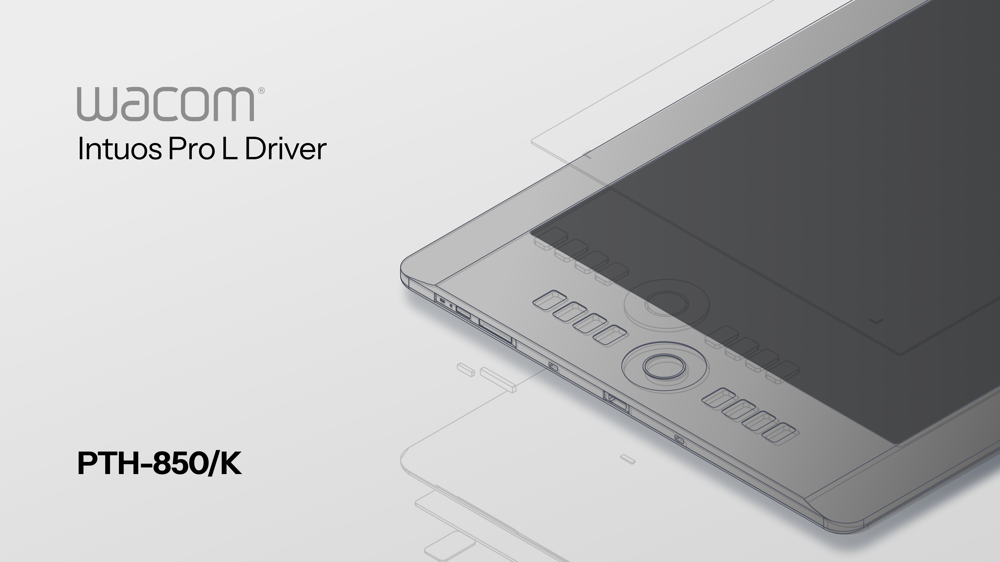
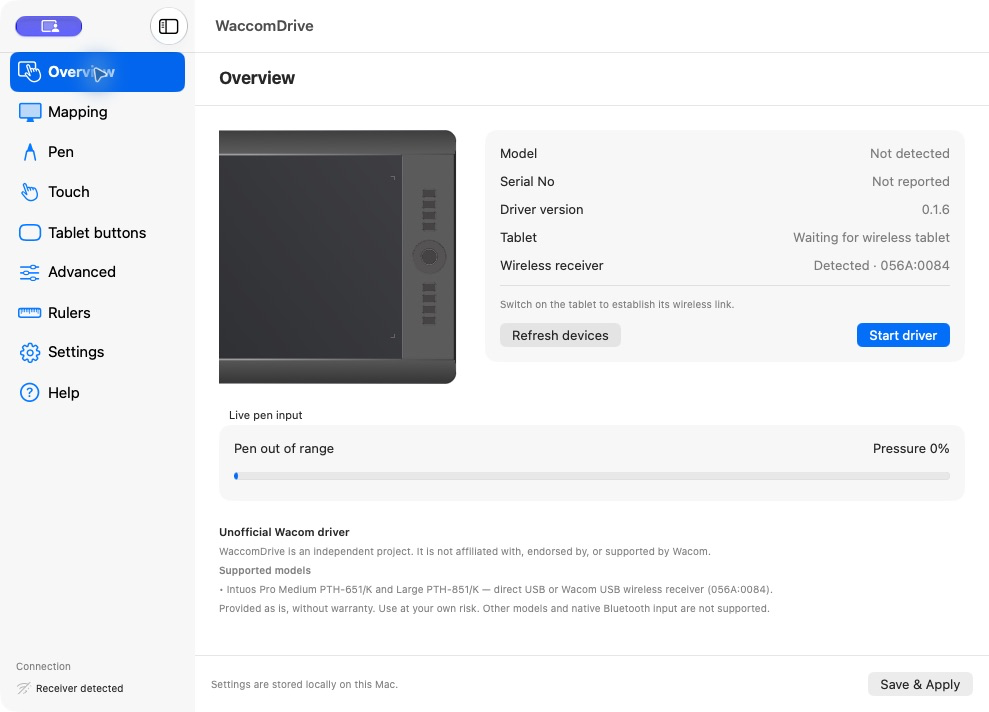
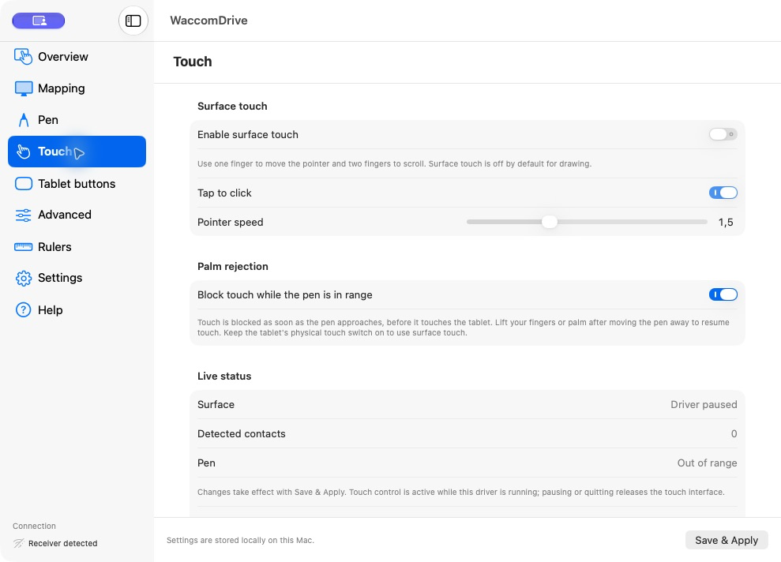
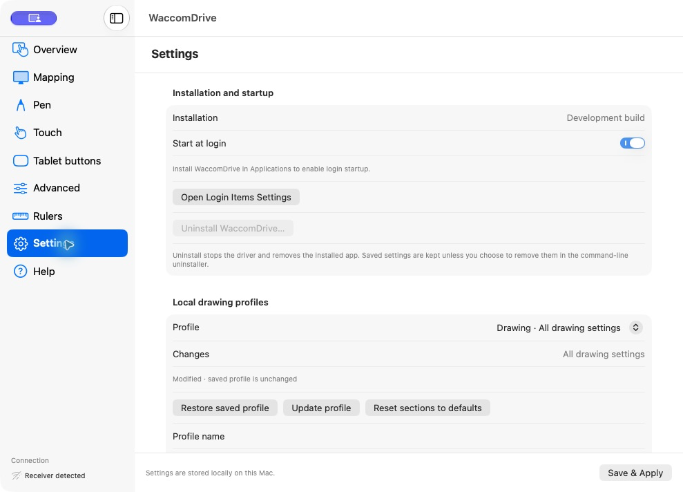

# WaccomDrive



A native macOS USB driver and settings app for the Wacom Intuos Pro Medium PTH-651/K and Large PTH-851/K. No third-party dependencies or kernel extension.

## Features

- Pen input with pressure, tilt, eraser detection, and configurable side buttons.
- Display mapping, tablet active area, rotation, and optional aspect-ratio preservation.
- Pressure sensitivity and tip activation controls, with named local JSON profiles and button-driven cycling.
- Adjustable pressure smoothing (0–50 ms; default 12 ms) softens report-to-report changes without delaying pen lift. Higher smoothing adds response delay.
- Custom pressure curve: adjust output at 25%, 50%, and 75% input with numeric entry and 0.1% steps. Native input remains 2,048 levels; output uses floating-point pressure, so software cannot create additional sensor detail.
- Eight ExpressKeys and ring-center button mapping with a visual tablet diagram, including Touch on/off.
- Custom keyboard shortcuts for pen buttons, ExpressKeys, and the ring center. Choose Custom shortcut, record a key (for example I for eyedropper) with optional modifiers, then Save & Apply. Escape cancels recording; custom keys stay held until the tablet button is released.
- Touch-ring brush-size control with direction and response settings.
- Surface touch on/off, one-finger pointer/tap, and two-finger scrolling.
- Pen-range palm rejection while the driver is active.
- USB receiver detection and tablet-reported connection capabilities.
- Wireless-module detection, battery percentage, and charging status over USB or the Wacom receiver.
- Settings save, backup, and import.
- Menu-bar access without a Dock icon.
- Installer, uninstaller, and start-at-login option.

## Screenshots

| Connection and battery | Display and tablet mapping |
| --- | --- |
|  |  |

| Pen pressure profiles | ExpressKey customization |
| --- | --- |
|  |  |

| Touch and palm rejection | Settings and installation |
| --- | --- |
|  |  |

## What works

Checklist for the Intuos Pro Large PTH-851/K. Checked items have recorded working behavior or automated checks, as noted. Unchecked items still need implementation or hands-on verification; implemented does not mean verified in a drawing app.

- [x] Direct USB pen input and basic drawing in Krita.
- [x] Pen hover/proximity, position, tip contact, dragging, and release (decoder/event checks).
- [x] Pressure input across the 0–2047 range (decoder/event checks).
- [x] Adjustable pressure sensitivity and tip activation threshold (settings/event checks).
- [x] Pen tilt X/Y decoding and tablet-event output (decoder checks).
- [ ] Confirm tilt-sensitive brush behavior in a drawing app.
- [x] Physical eraser switching and eraser pressure verified in a drawing app.
- [x] Two pen side-button mappings (event-generation checks).
- [x] Eight ExpressKeys and ring-center button decoding and action mapping (decoder/event checks).
- [ ] Verify physical ExpressKey numbering and every button on the tablet.
- [x] Button actions: right/middle click, undo/redo, brush/eraser shortcuts, brush size, Space/pan, and Shift/Option/Command/Control (mapping implemented; representative event checks).
- [x] Touch-ring brush-size shortcuts, direction reversal, and response adjustment (event-generation checks).
- [x] Touch-ring brush-size changes verified in a drawing app over the wireless receiver.
- [ ] Four selectable ring modes are not implemented.
- [x] Custom tablet active area, 180° rotation, and aspect-ratio preservation (mapping/settings checks).
- [ ] Verify display selection and mapped cursor alignment on real single/multiple-display setups.
- [x] Surface-touch enable/disable, one-finger pointer movement, tap-to-click, and pointer speed (event-generation checks).
- [x] Two-finger horizontal/vertical scrolling (event-generation checks).
- [x] Pen-range palm rejection and lift-to-resume protection (automated checks; requires exclusive touch-interface access).
- [ ] Verify touch gestures, palm rejection, and the physical touch switch end to end on the tablet.
- [ ] Pinch-to-zoom, rotation, and additional macOS trackpad gestures (not implemented).
- [x] Wireless-module presence, battery percentage, and charging-status decoding over USB (captured-report checks).
- [ ] Verify battery/charging updates across a live charge/discharge cycle.
- [x] Wacom USB receiver report decoding: pen, all eight ExpressKeys, ring, touch, battery, and disconnect cleanup (captured-report replay).
- [x] Wireless pen input and basic touch (pointer, tap-to-click, two-finger scrolling) confirmed on the PTH-851 receiver.
- [ ] Verify receiver disconnect/reconnect and wireless input recovery end to end.
- [ ] Verify pen, buttons, and gestures in drawing apps beyond Krita.

## Compatibility and limitations

- Requires macOS 27 or later; tested on macOS 27.0.1 with Apple silicon.
- Installer targets arm64; Intel Macs and universal builds are unsupported.
- Developed with Swift 6.4 and Apple's macOS SDK/tools.
- Tested devices: Intuos Pro Large PTH-851/K (`056A:0317`) and Medium PTH-651/K (`056A:0315`). macOS may advertise them as Intuos5 touch L/M.
- Supports PTH-651/K (`056A:0315`) and PTH-851/K (`056A:0317`) over direct USB or Wacom receiver `056A:0084`, using model-specific pen coordinates. Medium USB pen input confirmed in a short drawing test; its other controls and receiver input still need hands-on verification. Other models are rejected. Native Bluetooth input is unsupported.
- Basic pen input tested in Krita; wireless pen, basic touch, and touch-ring brush-size changes verified. Other apps and advanced mapping still need testing.
- No pinch, rotation, or full macOS trackpad gestures.
- Palm rejection requires exclusive touch-interface access and an active driver.
- Concurrent use with other tablet drivers is unverified.
- Requires Input Monitoring and Accessibility permissions.
- ExpressKey numbering, tilt-specific brush behavior, and the complete install/login/uninstall cycle remain unverified.

## Build and run

```sh
./script/build_and_run.sh
```

- Builds the app and diagnostic CLI, runs checks, and opens `build/WaccomDrive.app`.
- Build only: `./script/build_and_run.sh --build`.
- Create an installer: `./script/package.sh --local`.
- Installer output: `build/installer/`.
- Welcome artwork: `previews/cover-dev.png` for local builds; `previews/cover.png` for production (`--release` / `--signed-app`).
- Uninstall from Settings or use the companion `Uninstall WaccomDrive.command`.
- GitHub Actions are excluded; builds run locally.

## Signing

- The build selects an available Developer ID Application or Apple Development identity; otherwise it uses ad hoc signing.
- Override the identity with `WACCOM_SIGN_IDENTITY`:

```sh
WACCOM_SIGN_IDENTITY='Developer ID Application: Your Name (TEAMID)' ./script/build_and_run.sh --build
```

- Forks can build and run locally without the original developer's certificate or a paid Apple Developer account. The build falls back to ad hoc signing when no signing certificate is available.
- To explicitly use ad hoc signing: `WACCOM_SIGN_IDENTITY=- ./script/build_and_run.sh`.
- Local builds still require Input Monitoring and Accessibility. Ad hoc rebuilds may require granting those permissions again; signing does not grant them automatically.
- Ad hoc signing is sufficient for local builds but does not provide Gatekeeper trust for downloaded apps. Developer ID signing and notarization are needed for normal distribution outside the Mac App Store.
- Distribution app ZIP: `./script/package.sh --signed-app` with a Developer ID Application identity.
- Distribution installer: `./script/package.sh --release`; also requires Developer ID Installer, selected automatically or through `WACCOM_INSTALLER_IDENTITY`.
- Downloaded releases also need Apple's notarization process for default Gatekeeper acceptance.
- Keep certificates, private keys, and credentials outside source control.

## Settings and diagnostics

- Settings: `~/Library/Application Support/WaccomDrive/settings.json`.
- Pressure profiles: individual JSON files in `~/Library/Application Support/WaccomDrive/PressureProfiles/`. Manage them on Settings; backups include profiles.
- Assign Cycle pressure profiles after creating profiles. Each press advances through the displayed list and applies it at the next pen lift if a stroke is active.
- Save & Apply activates changes; imported settings require Save & Apply.
- Brush-size actions use the drawing app's `[` and `]` shortcuts.
- CLI device inventory: `build/waccom-capture --probe`.
- Decoder and settings checks: `build/waccom-capture --self-check`.
- Capture replay: `build/waccom-capture --replay=captures/first-session-excerpt.txt`.

## Support for other devices

- Help add support for other Wacom Intuos and Intuos Pro models by submitting a guided capture. Captures provide evidence for decoding; they do not enable support automatically.
- The [capture tool and its source](tools/capture/) are included separately from the driver: a native Swift HID recorder and a Python guide. It records device identity, capabilities, and raw input while guiding you through pen, touch, buttons, rings/dials, wireless, and battery checks. You manually confirm each step; unavailable features can be skipped.
- Quit tablet drivers, connect your tablet, then run `./tools/capture/capture_tablet.command` from the project folder. Requires macOS, Apple's Command Line Tools with Swift 6, and Python 3. See [full capture instructions](tools/capture/README.md).
- Compress the complete session folder from `tools/capture/captures/` as a ZIP. Name it with the exact model code printed on the **back of the tablet** and its release year, for example `PTH-851-K_2013_USB.zip`. Use the model's release year, not its purchase year; write `year-unknown` if unsure. Keep the files inside unchanged.
- [Open an issue](https://github.com/lorddarq/waccomDrive/issues/new) titled `Device support: <model code> (<release year>)` and attach the ZIP. Include the product name/size, macOS version, Mac chip, connection type (USB, Wacom receiver, or Bluetooth), receiver model/USB ID if present, pen model if known, and any incomplete steps or unusual behavior. A photo of the back label helps; hide serial numbers and barcodes.
- Review captures before sharing: raw data may contain identifying information. Nothing is uploaded automatically. Submit separate captures for each model and connection type when possible.

## Tablet artwork

- [Model index](assets/tablet/models.json): Intuos Pro models and three SVG slots per model—base, overlay, and ExpressKeys.
- Existing artwork is assigned to PTH-851; unassigned models use `null` image locations.
- See [catalog format and image roles](assets/tablet/README.md).

## Distribution

You may freely use and build on top of the available source code, as long as you credit back in the license.

## Advanced pressure processing

Advanced → **Advanced features** defaults off, including when loading older version-1 settings. Off (or pressure processing disabled) retains the original curve and 12 ms EMA default. Enabled processing replaces baseline EMA with bypass, fixed contact pressure (0–100%), sample-and-hold (1–64 reports, 1–100 ms acquisition), a timestamped moving average (1–100 ms), or EMA (0–50 ms). Reset restores disabled processing with EMA 12 ms, fixed 50%, four reports, 30 ms acquisition, and a 12 ms window.

Sample-and-hold delivers a running average immediately, then freezes after N reports or when the next report reaches the timeout. No timer invents pressure reports during silence; short strokes are never withheld. Moving average keeps at most 1,024 timestamped reports, evicting oldest entries at capacity. Larger windows/time constants intentionally delay pressure response. These controls add no sensor resolution.

Pressure ordering is native raw / 2047 → existing response curve → selected processor → optional speed gain → final [0,1] clamp → tablet event. Contact/down/up always follows raw proximity and tip threshold, including fixed 0%. Position uses model-specific mapping independently; future speed must use raw mapped positions and monotonic timestamps before stabilization/projection.

Pen lift, tool switch, session reset, pause, disconnect, and model changes clear processing history; release pressure is always zero. Save & Apply queues settings during contact and applies after lift; pressure-profile cycling queues only pressure settings and preserves held buttons. Preview reads input/output on a separate 20 Hz timer while the app is active. Optional settings live in settings.json; version-1 pressure-profile JSON remains unchanged. Settings owns profile management; Rulers has a separate navigation destination pending its own feature task.

Automated verification: compile Swift 6 with warnings as errors and run the diagnostic CLI --self-check, which includes timestamped pressure traces at 50, 133, 200 and 1,000 reports/second. These are generated-event checks, not evidence of live drawing performance. Long USB/receiver sessions, native keyboard/layout acceptance, and Krita plus another drawing app remain unverified for these advanced modes. No packaging, signing or release is implied.

### Precise advanced pressure curves

Advanced → Use advanced curve explicitly opts into a separate curve; existing Pen curves and sensitivity remain the baseline when Advanced features is off. Copy baseline curve starts with its five anchor values. Smooth uses shape-preserving piecewise cubic Hermite interpolation; Linear joins anchors directly. Settings changes prepare coefficients once for delivery, before time-based pressure processing. No new positional smoothing is applied.

Use 2–8 anchors including input endpoints 0% and 100%. Select an anchor and fine-tune its input/output pressure with sliders, drag a graph handle, use arrow keys for 0.1% changes, or enter both exact input/output percentages and choose Apply anchor. Sliders stop at neighboring anchors to preserve ordering; endpoint inputs stay fixed. Invalid or duplicate input positions and nonmonotone output are rejected without replacing the last valid curve. Add inserts between the selected anchor and its successor; Delete removes interior anchors. Linear reset, Soft, and Firm provide starting shapes. Inverted response explicitly reverses outputs; raw tip lift always releases with zero pressure. A maximum-output anchor before 100% input creates a plateau.

Advanced curve data is optional in local settings and existing version-1 pressure profiles/backups. Older payloads remain readable and retain their prior response. Selecting a profile never enables the Advanced features master switch. Unified advanced preset management remains separate planned work. The graph edits draft settings; Save & Apply activates them after the current stroke.

### Pulled-string position smoothing

Advanced → Enable pulled string adds a distance stabilizer after model/display mapping, before future ruler projection. String length is in macOS logical screen points (0–500; default 12, off by default), with a continuous slider, numeric entry and 0.1-point stepper control. It is independent of tablet model and display pixel density. The Advanced features master switch must also be on; zero length and either switch off are exact positional bypass. Save & Apply defers changes until lift and keeps saved string settings when the master is off.

Each stroke starts at the mapped pen point. Subsequent real contact reports hold that point while the pen remains within the string radius; beyond it, the output follows at the configured distance. Longer strings intentionally create distance lag and change corner handling. Pressure, tilt and buttons still update on held-position reports. Hover and button-only navigation stay direct. During a stabilized stroke, button actions use the last delivered position rather than jumping to raw input.

Lift releases at the last delivered point with pressure zero, without a catch-up tail; later hover reports resume direct navigation. Stroke start, tool/model/display changes and session reset/pause/disconnect clear string history. The filter uses constant state and no timer, batching or screen queries per report. Raw mapped positions remain separately available for future speed calculation. Local settings/backups store the optional pulledString field; legacy payloads remain off. Advanced per-profile presets remain a separate task.

Automated string checks cover repeated points, taut distance, corners/circles, bypass gates, rotation/crop/aspect and model mapping, pressure/tilt while held, lift/hover/button behavior, and session lifecycle resets. Actual USB/receiver drawing and delivery-stall acceptance require physical testing of this feature.


The optional **Show string guide over apps** control displays a screen-level, transparent, click-through panel while a pulled-string stroke is active. A small ring follows raw mapped input, a dot marks stabilized output, and the connecting line plus dashed length circle explain when the string is slack or taut. Painting apps keep their own cursors; the guide cannot become key/main or intercept mouse events. It uses one fixed transparent window on the mapped display, renders rings/line/dot with seven GPU-composited Core Animation shape layers instead of per-frame NSView painting, refreshes paths from latest state at up to 60 Hz without implicit animations, caches display coordinate conversion, and hides on lift/pause/disconnect or effective bypass. It does not render or query displays inside HID callbacks. Guide visibility defaults on for an enabled string, including older saved string settings; the stabilizer itself still defaults off. Save & Apply uses the existing safe stroke boundary.

Native overlay check: compile and run the commands at the top of script/check_string_guide.swift. It verifies transparent/click-through/nonactivating window behavior, screen placement and hide-on-lift with a synthetic snapshot; this is separate from physical drawing across apps/displays.


### Pressure gain by pen speed

Advanced → Enable speed pressure gain derives velocity from consecutive raw mapped positions in logical points/second, before pulled-string/ruler position changes. Optional elapsed-time EMA averages speed (0–100 ms, default 0); higher values intentionally delay gain response. Interpolate between slow/fast thresholds (0–10,000 points/s, strictly increasing) and their gains (0–4×), saturating outside the thresholds. Slow gain below fast gain makes faster movement thicker; reverse them for thinner fast strokes. Defaults are off, 0/1,000 points/s and both gains 1×, preserving exact pressure output.

The order is raw pressure normalization → response curve → pressure processor → speed gain → final clamp to [0,1]. Fixed and sample-and-hold pressure may therefore vary with speed when explicitly enabled. Raw contact still owns down/up. First contact, invalid/nonfinite timestamps, intervals below 1 microsecond and gaps over 100 ms use neutral 1× gain and reseed history. Preview speed is bounded to 100,000 points/s to limit outliers; gains saturate by the configured fast threshold. Lift, pause, disconnect, tool/model/display/mapping/profile changes reset velocity history.

Settings/backups store optional pressureSpeed data; absent data remains off. The shared Advanced features switch bypasses speed gain without erasing parameters. Save & Apply uses the existing stroke boundary; reset restores disabled neutral defaults. Live speed/gain use the existing foreground preview timer, only publish changed values, and show applied settings rather than unsaved drafts. No timers, queues, UI, or disk work were added to the HID path. Unified per-profile speed presets remain the separate presets task.

### Ruler development build

The Rulers page now provides an initial numeric editor for radial, isometric,
direct vanishing-point construction and a projectively transformed circle.
Enable **Advanced features**, enable the ruler, then **Save & Apply**. Accuracy
0% is guide-only; 100% projects contact positions after pulled-string smoothing.
Guides stay fixed in logical screen coordinates and pass clicks through.

Guides use retained Core Animation shape layers for GPU composition. CPU path
construction runs only when configuration/display layout changes; pen reports do
not redraw the guides. Snapping remains bounded CPU geometry in the input path.
This does not establish an FPS improvement: live drawing/performance acceptance
is still pending. `script/check_ruler_overlay.swift` verifies native layer and
window behavior; the CLI self-check includes projection and lifecycle checks.

Use the **ruler bar on the canvas** (upper right of each display) to choose a
ruler and click **Edit ruler**. Click **Done** to return to drawing. The driver
window is only needed for precise numeric configuration. The menu bar and Rulers
page retain their editing shortcuts. Guides preview continuously while dragging; release validates and
saves the geometry, and Finish Editing restores drawing. Move/rotate handles are
distinct from point controls; projected ellipses also have edge and uniform-size
handles. Isometric rotation is separate from its axis angle. Invalid changes and
cancelled gestures leave the saved geometry intact.
Only handles capture clicks; guides remain click-through. Off-screen points have
edge handles that preserve their offset during dragging and are spaced apart
when several controls fall outside the same display edge. The menu bar also
provides Show/Hide Ruler Guides without changing snapping. In edit mode, string
and ruler position processing are temporarily bypassed so handles follow input.

Automatic direction selection waits for at least 8 screen points and a clear
family, then locks until lift. The acquisition distance is adjustable; select a
Direction family explicitly when directions are nearly parallel.

This is an incomplete development increment: camera-based perspective, scene-line
matching, extended construction modes and the remaining ruler
families are tracked in the ruler task. The Perspective entry currently exposes
direct vanishing-point construction, not camera/FOV controls. Perspective-ellipse
snapping uses a bounded 512-segment approximation of the transformed circle.

### Dedicated input thread

In **Settings → Input threading**, **Use dedicated input thread** defaults on
for new installations and older settings without a saved preference. Explicitly
saved off choices are preserved. To change the mode, choose **Save & Apply**, then
quit and reopen the app. Help explains scheduling priority, rollback and timing
comparisons. The active mode and
any pending restart appear below it. Pausing/resuming the driver does not switch
threading modes. Uncheck, save and restart to return to the main-thread path.

Dedicated mode gives the existing tablet session one user-interactive-priority
run loop: HID reception, watchdog, pen/touch/button processing, safe settings
changes and event posting stay together. UI and overlay rendering remain on the
main thread. Serialized commands and copied preview values cross the boundary;
pen reports do not enqueue UI updates. Priority is a scheduler hint, not an
exclusive CPU core or a real-time guarantee. The algorithms are unchanged.

Timing reports include the active input thread. Compare main/dedicated modes with
Advanced off and again with your combined advanced effects and guides on. Reset
before each continuous-stroke sample. Compare callback gaps/bunching and drawing
feel, and check immediate lift, button releases, settings changes and disconnects.
The automated threading check deliberately stalls the main thread and verifies
that dedicated-loop work continues; it also checks captured positional replay
parity with the advanced pipeline enabled, JSON defaults and repeated cleanup.
Live latency and full combined-feature acceptance remain necessary.
